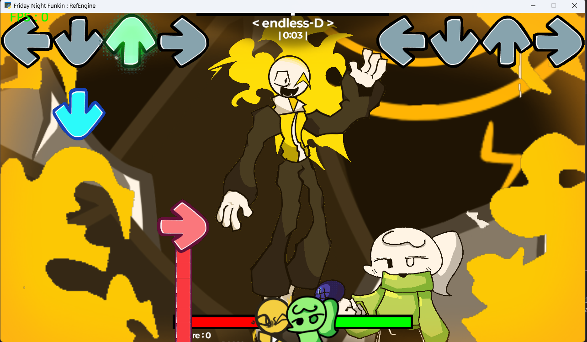
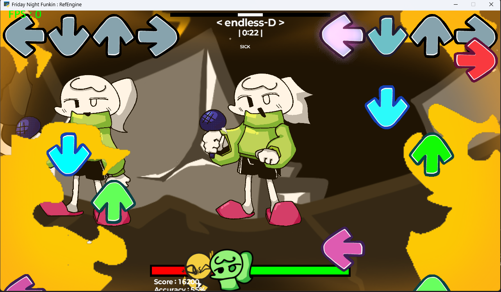

# RefEngine

Python과 Arcade로 만드는 Friday Night Funkin' 스타일 리듬 게임 엔진입니다. 아직 개발 중이지만 곡 선택, 판정과 롱 노트, 모드 애셋 덮어쓰기, 노래·노트별 Python 스크립트를 지원합니다.

## 시작하기

Python 3.13 / Arcade 3.3.3 환경에서 확인했습니다. 프로젝트 루트에서 실행하세요.

```powershell
python -m pip install arcade blinker pillow
python run.py
```

메뉴에서 곡을 고른 뒤 **START**를 누르세요. `python run.py demo:track`처럼 실행하면 모드 곡이 미리 선택됩니다. 로딩 중에는 이미지·오디오를 작업 스레드에서 읽고, GPU 텍스처는 메인 스레드에서 단계별로 준비합니다. 진행 막대와 화면 전환이 끝나면 음악을 시작합니다.

| 위치 | 조작 |
| --- | --- |
| 메뉴 | `↑` / `↓`로 선택, `Enter`로 시작 · 마우스로 선택 및 START 클릭 |
| 플레이 | `D` `F` `J` `K` 또는 방향키로 노트 입력 |
| 볼륨 | `-` / `+`로 마스터 볼륨을 10%씩 조절 (0~100%) |

숫자 키패드의 `−`·`+`도 볼륨 조절에 쓸 수 있습니다. 로딩에 실패하면 오류를 확인하고 `Esc`로 메뉴에 돌아갈 수 있습니다.

## 프로젝트 구조

| 경로 | 내용 |
| --- | --- |
| `run.py` | 창 생성과 메뉴 시작 |
| `sources/views/` | 곡 선택, 로딩, 게임 화면 |
| `sources/game/` | 노트·캐릭터·카메라·점수 등 게임 매니저와 이벤트 |
| `assets/songs/` | 기본 곡 차트와 `Inst.ogg`·`Voices.ogg` |
| `assets/notes/` | 노트 종류별 설정과 이미지 |
| `assets/scripts/` | 기본 노래 스크립트와 `notes/`의 노트 스크립트 |
| `assets/shaders/` | 곡별 화면 효과의 GLSL 파일 |
| `mods/` | 기본 애셋을 덮어쓰는 모드 |

## 모딩

모드는 `mods/<mod_id>/assets/` 아래에 기본 `assets/`와 같은 경로로 놓습니다. 같은 경로의 파일이 있으면 모드 파일이 우선하고, 없으면 기본 애셋을 사용합니다. 곡은 메뉴에 `mod_id:song_id`로 나타납니다.

```text
mods/demo/assets/
├─ songs/track/
│  ├─ data.json
│  ├─ Inst.ogg
│  └─ Voices.ogg
├─ notes/my_note/data.json
├─ scripts/my_song.py
└─ scripts/notes/my_effect.py
```

- 곡의 `data.json`에서 `"scripts": ["my_song"]`으로 `SongScript(game)`를 지정합니다.
- 노트의 `data.json`에서 `"scripts": ["my_effect"]`로 `NoteScript(game, note)`를 지정합니다. 각 노트는 자기 스크립트 인스턴스를 가집니다.
- 곡의 `data.json`에서 `"shaders": [{"name": "my_effect", "uniforms": {"strength": 0.2}}]`로 전체 화면 효과를 지정합니다. `assets/shaders/my_effect.frag`는 모드에서 덮어쓸 수 있습니다.
- [한국어 모딩 가이드](mods/README.ko.md)와 [English modding guide](mods/README.md)에 차트 형식, 필수 파일, 스크립트 예제와 이벤트가 있습니다. 매니저·노트 API는 코드의 영어/한국어 docstring에서도 확인할 수 있습니다.

### GIF 캐릭터 생성기

`python sprite_generator.py`를 실행하면 Tkinter 창에서 GIF, 애니메이션 이름, 속도, 오프셋, 반복 여부와 추가 JSON 속성을 입력할 수 있습니다. 기본 동작 외에 `sing_*_alt` 애니메이션도 지원합니다. 생성기는 루트에 `<이름>.json`을 내보내고 `assets/characters/<이름>/`에 `data.json`과 GIF를 설치합니다. 모드 전용 캐릭터로 쓰려면 해당 폴더를 모드의 `assets/characters/`로 복사하세요.

## 개발

변경 후 전체 테스트를 실행합니다.

```powershell
python -B -m unittest discover -s tests -v
```

## 미리보기

<p align="center">
  
  
</p>
